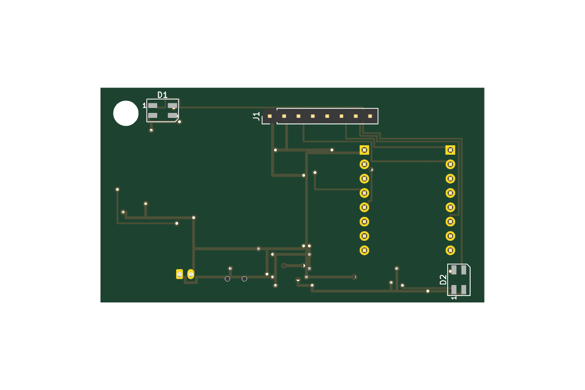
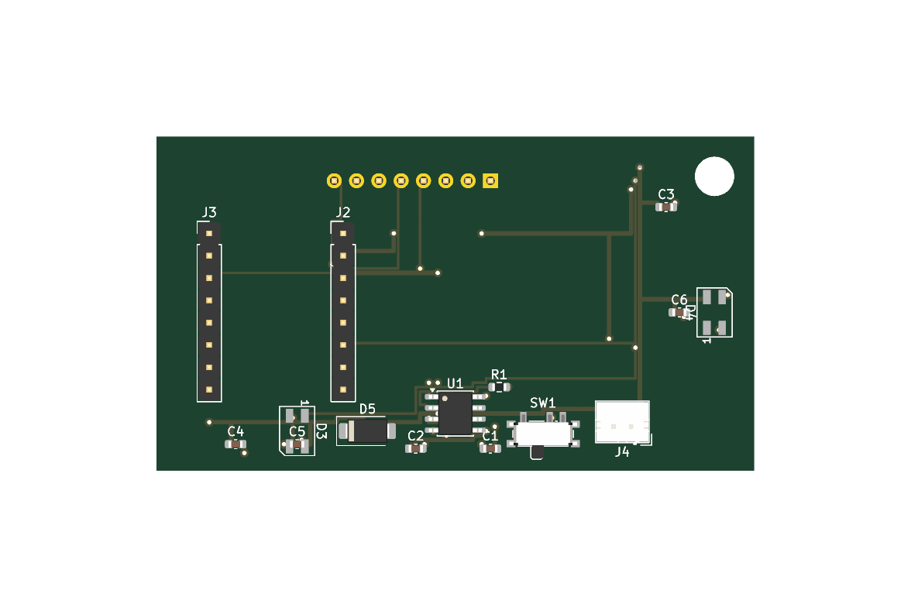

# PCB-Keychain
A simple yet cool and functional pcb keychain. Exactly what it sounds like!

## What it is
A small keychain about the size of a 2.36" colour e-ink screen. The screen sits flat on the front of the board, and there are four little RGB LEDs, two on each side, so it lights up whichever way it's hanging.

I kept it simple on purpose. The brains are an ESP32-C3 SuperMini, a tiny dev board that already has USB-C, a regulator and a boot button on it, so I just solder it onto the back with headers. The e-ink screen comes on Waveshare's driver board and plugs into an 8-pin header at the top.

It runs off a small LiPo. A TP4056 charges it from the SuperMini's USB-C, a slide switch turns it on and off, and a diode lets the battery power the board when it's unplugged. Because e-ink keeps its picture with no power, the battery lasts a long time.

## Parts
Full list in [bom.csv](bom.csv).

Cost: about $28.35 USD for one keychain (single-unit prices from LCSC, Waveshare, Tindie and Adafruit, not counting the PCB, shipping or LCSC minimum order quantities).

- ESP32-C3 SuperMini
- Waveshare 2.36" e-Paper Module (G)
- 4x SK6812MINI LEDs
- TP4056 charger, SS14 diode, slide switch
- JST-PH 2-pin LiPo connector
- A few 0603 caps and one resistor

## Files
KiCad project is in `kicad/`. Open `keychain.kicad_pro`.
